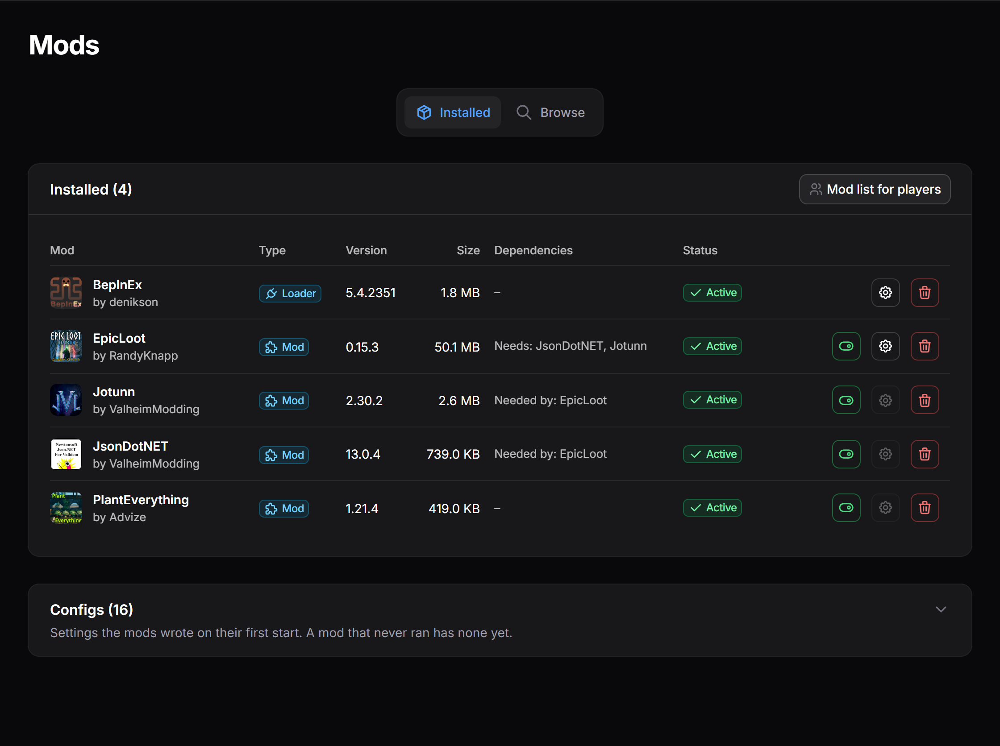
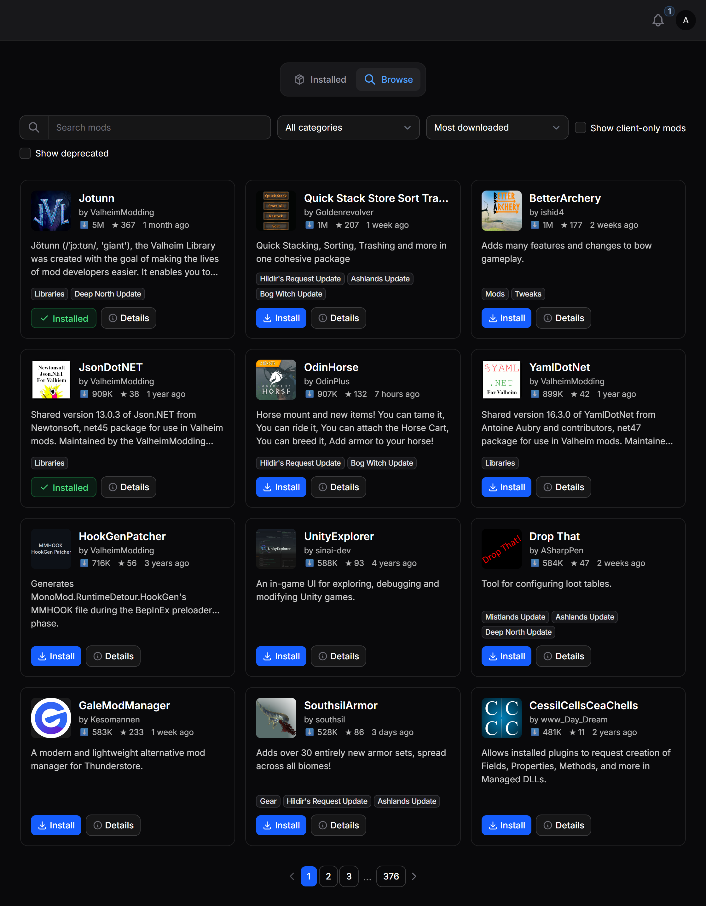
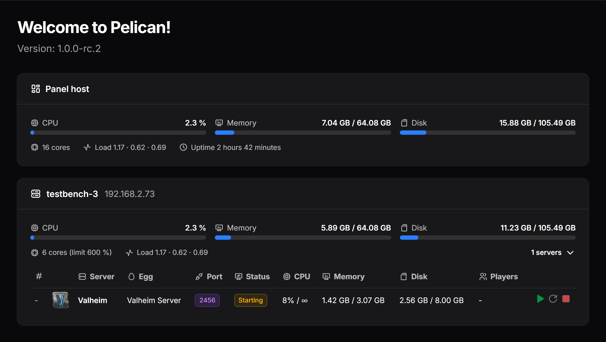
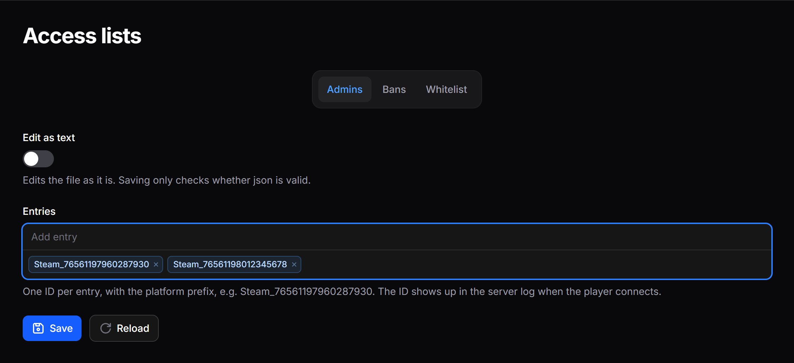

# Pelican Eggs & Plugins

Custom and modified eggs plus custom plugins for the Pelican panel.

<p align="center">
  
</p>

## Requirements

Pelican panel `1.0.0-rc.2` or any newer `1.x`. The plugins declare this as `panel_version` and Pelican marks them incompatible on anything else.

## Eggs

All eggs sit flat in `eggs/`. Import one under **Admin → Eggs → Import**; to update an egg that is already in the panel, import it onto that egg instead of creating a new one. An updated install script only runs for servers installed or reinstalled afterwards.

| Game | Egg file | Server type |
|---|---|---|
| Counter-Strike 1.6 | `eggs/egg-counter-strike-16.json` | GoldSrc |
| Counter-Strike: Condition Zero | `eggs/egg-counter-strike-condition-zero.json` | GoldSrc |
| Counter-Strike: Source | `eggs/egg-counter-strike-source.json` | Source |
| Counter-Strike: Global Offensive | `eggs/egg-counter-strike-global-offensive.json` | Source |
| Counter-Strike 2 | `eggs/egg-counter-strike-2.json` | Source |
| Minecraft Paper | `eggs/egg-minecraft-paper.json` | Minecraft |
| TeamSpeak-6 Server | `eggs/egg-teamspeak-6-server.json` | Voice |
| Valheim Server | `eggs/egg-valheim-server.json` | SteamCMD |

## Plugins

Source code lives in `plugins/<name>/`, the deploy artifact is `plugins/<name>.zip`.

| Plugin | Purpose | Panel |
|---|---|---|
| [Access Lists](plugins/access-lists/README.md) | Edit a server's admin, ban and whitelist files from the panel | Admin + Server |
| [Game Query](plugins/game-query/README.md) | Query players, map and server info | Admin + Server |
| [Mod Manager](plugins/mod-manager/README.md) | Browse and install mods per server, set up per egg (Valheim so far) | Admin + Server |
| [Server Navigation](plugins/server-navigation/README.md) | Hide sidebar entries per server | Admin + Server |
| [Server Resources](plugins/server-resources/README.md) | Resources of host, nodes and servers on the admin dashboard | Admin |

### Screenshots

**Mod Manager** - installed mods with their loader, dependencies and configs, and the Thunderstore browser:





**Server Resources** - panel host, nodes and their servers on the admin dashboard:



**Access Lists** - a Valheim admin list edited from the server page:



### Installing a plugin

Upload `plugins/<name>.zip` under **Admin → Plugins → Import from File** and install it there, or copy the folder to `/var/www/pelican/plugins/<name>/` and run:

```bash
cd /var/www/pelican
sudo -u www-data php artisan p:plugin:install <name>
```

After installing or updating, clear the caches and restart PHP-FPM so the new code is loaded (adjust the PHP version):

```bash
sudo -u www-data php artisan optimize:clear
systemctl restart php8.4-fpm
```

Each plugin's README covers what it needs set up in the admin panel.

### Building

After every plugin change, bump the version in `plugin.json` and rebuild the ZIP:

```
python scripts/build.py game-query
```

## Sources

- [Pelican Project](https://pelican.dev/)
- [Pelican Eggs](https://github.com/pelican-eggs)

## License

[AGPL-3.0](LICENSE), the same license as Pelican itself.

The eggs build on the [Pelican Eggs](https://github.com/pelican-eggs) collection, which is released under the MIT license; its copyright notice applies to the parts taken from there.
